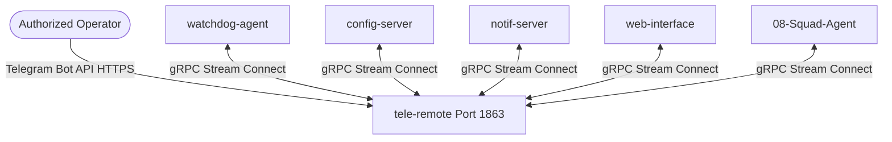

# 🗼 Architecture Overview: tele-remote

The **tele-remote** microservice serves as the bidirectional Telegram command-and-control and telemetry bridge for the Bastien-Antigravity ecosystem.

## 🔗 Context & Placement
* **Tier**: `#tier/1-gateway` (L1 Base Fleet Gateway)
* **Primary Technologies**: `#tech/go` (Go + gRPC Bidirectional Streams + Telebot v3)
* **Central Integration**: Accepts persistent gRPC bidirectional streams (`teleremote.TeleRemoteService/Connect` on port `1863`) from fleet microservices (`watchdog-agent`, `config-server`, `notif-server`, `web-interface`, `08-Squad-Agent`, `obsidian-rag`) and polls the Telegram Bot API.

## 📐 Structural Overview

